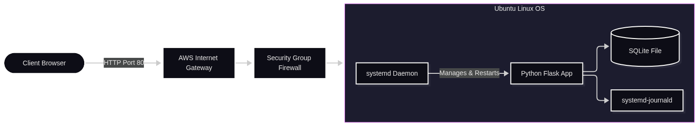

# Project 01: Python Flask Monolith & Linux Systemd on AWS EC2

## Project Overview

Introduces the traditional architecture that powered the early web and still underpins thousands of production systems: running a monolithic web application directly on a Linux virtual machine managed by an OS daemon (`systemd`), with cloud infrastructure provisioned through Infrastructure as Code (Terraform).

## System Design & SRE Concepts Learned

1. **HTTP Request Lifecycle:** DNS resolution, Internet Gateway routing, Security Group firewall evaluation, Linux kernel socket handling, and application request dispatching.
2. **Monolithic Architecture:** Presentation, Business Logic, and Data Access combined in a single unit with zero inter-service network serialization overhead.
3. **OS Process Supervision (systemd):** Why web apps must never run in raw terminals. Configuring service unit restart policies (`Restart=always`), stdout/stderr capturing in `journald`, and PID tracking.
4. **Declarative Infrastructure as Code:** Raw unabstracted Terraform (`main.tf`) defining VPC, subnets, and EC2 instances.

## System Architecture Diagram

## Project Structure

* `README.md` - Core system design, architecture diagrams, and concept explanations.
* `TOOLS_AND_TECHNOLOGIES.md` - Deep-dive into each technology used, alternatives, and role in SRE.
* `learning/` - SRE interview preparation, reading list, and incident post-mortems:
    * `learning/questions_asked.md` - Technical questions, architecture dilemmas, and SRE concepts log.
    * `learning/INCIDENTS.md` - Simulated SRE failure drills (Crash loops, Security Group timeouts).
    * `learning/INTERVIEW_PREP.md` - SRE interview questions, failure scenarios, and technical defense.
    * `learning/READING_LIST.md` - Curated high-yield 5-to-10 minute readings to reinforce theory.
* `app/` - Production application source code, templates, and unit tests.
* `systemd/` - Linux OS service unit configuration (`skills-tracker.service`).
* `terraform/` - AWS Infrastructure as Code (`main.tf`, `variables.tf`, `outputs.tf`).
* `sre-tests/` - Post-deployment synthetic monitoring probes and load-testing scripts.
