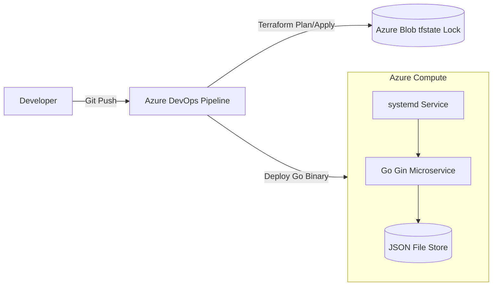

# Project 02 - Go Microservice with Gin on Azure VM

## 🎯 Project Overview
Introduces Golang from the perspective of an SRE. We build a high-performance compiled microservice using Gin, deploy it to an Azure Ubuntu VM, and configure Terraform remote state locking with Azure Blob Storage.

## 🧠 System Design & SRE Concepts Learned
1. **Compiled vs Interpreted Binaries:** Why Go produces a single, statically linked binary with no Python/Node runtime dependency.
2. **Go Syntax for SREs:** Structs, JSON tags, goroutines, and error handling patterns.
3. **Remote State Management & State Locking:** Why storing `terraform.tfstate` in Git is dangerous, and how Azure Blob Storage locks prevent concurrent pipeline overwrites.
4. **Azure DevOps (ADO) Pipelines:** Service connections, pipeline variables, and YAML execution stages.

## 📂 Project Structure
* `README.md` - Core system design, architecture diagrams, and concept explanations.
* `TOOLS_AND_TECHNOLOGIES.md` - Deep-dive into each technology used, alternatives, and role in SRE.
* `INTERVIEW_PREP.md` - SRE interview questions, failure scenarios, and technical defense.
* `READING_LIST.md` - Curated high-yield 5-to-10 minute readings to reinforce theory.
